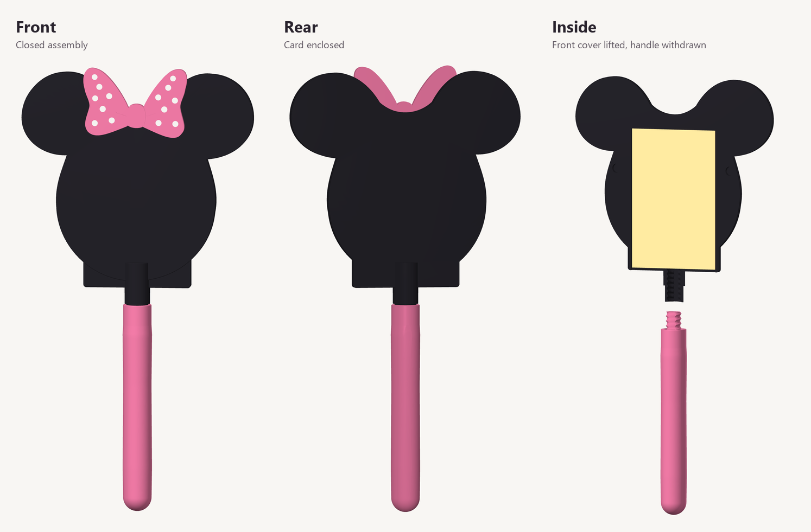

# Minnie CR80 card wand

A portrait card enters through the bottom of the head. The pink screw-in handle carries the collar and closes the exit. The head is 128.04 mm across the ears. The assembled wand measures approximately **128.04 × 245.85 × 15.91 mm** in X, Y and Z. All print parts use ASA.



## Print files

The [editable assembly STEP](minnie_card_wand.step) shows the closed wand. The [K2 plate notes](../asa_slicer/README.md) cover the final slicing setup. The STLs below use millimeters and share the closed assembly’s coordinate system. X runs left to right across the head, +Y runs from the grip toward the bow, and +Z points out of the decorated face. The card and screw axis meet at X = Z = 0.

| STL | Quantity | ASA appearance | Approximate X × Y × Z, mm | Initial print pose |
|---|---:|---|---|---|
| [Front shell](print_parts/front_black.stl) | 1 | Galaxy Black | 128.04 × 137.87 × 6.25 | Inner face on bed, assembly axes as supplied |
| [Middle spacer](print_parts/spacer_black.stl) | 1 | Galaxy Black | 128.04 × 118.87 × 1.50 | Flat in XY |
| [Rear shell](print_parts/rear_black.stl) | 1 | Galaxy Black | 128.04 × 137.87 × 6.25 | Rotate 180° around X, inner face on bed |
| [Alignment plug](print_parts/alignment_pin_black_print_two.stl) | 2 | Galaxy Black | 5.32 × 5.32 × 3.20 | Circular end on bed |
| [Handle and integral cuff](print_parts/handle_cuff_pink.stl) | 1 | Pink ColorMix | 16.20 × 125.00 × 15.91 | Long Y axis parallel to bed, rear chord down |
| [Bow](print_parts/bow_pink.stl) | 1 | Pink ColorMix | 57.16 × 38.16 × 3.90 | Print together with white dots, decorated face near vertical |
| [Bow inlays](print_parts/bow_dots_white.stl) | 1 set of 14 | Solid White | 47.89 × 28.77 × 1.05 overall | Same object transform as bow |

Drop each independent object to the bed after orientation. Load the bow and inlay files as two parts of one object at their original common origin. The plug STL is centered in the left seat in assembly space. Translate a second copy +73.768745 mm in X to reconstruct the right seat. The STEP already includes both.

The 0.4 mm K2 process uses physical red T1 and white T2 for the virtual pink recipe. The dots use solid white. The bow has fourteen flush 1.05 mm deep inlays, approximately 3.16–3.40 mm across, a raised knot and two recessed folds. A steep bow face shows the alternating color layers. The black shells print separately with continuous flat card-contact faces.

## Fit coupon and assembly

1. Print the [four coupon files](fit_coupon/) at 100% in the intended ASA, nozzle, layer height and final component poses. The spacer coupon contains two side rails. Match the cut ends and outer edges of the rails to the front and rear coupon ends. Hold or lightly clamp the sandwich at the side rails. The stub handle includes the complete male thread and cuff.
2. With the stub removed, pass the actual card’s short edge through the assembled coupon. Fit the stub by hand and confirm its collar surrounds the stem freely. Verify removal and card release. The coupon is open at its upper cut face and checks the real mouth, side clearance and thread. The full head provides the seated upper stop.
3. For the full head, dry-fit the two chamfered plugs through the spacer into the blind seats in the front and rear covers. The spacer’s closed end faces the bow. Keep the inner faces smooth. Check the actual card slides through the bottom while the handle is removed.
4. Bond the fixed black sandwich with an ASA-compatible adhesive applied sparingly at the outer mating margins and plug seats. Keep the card out and keep adhesive away from the channel, inner faces, split stem and thread. Hold the shells registered and allow the bond to cure. Seat the bow against the two front bosses and bond its fixed contact patches. The white dots are co-printed. The handle and cuff form one removable piece.
5. Insert the card short edge first. Screw the handle clockwise as viewed from the grip end. The integral cuff slides over the two black stem halves and resists the spreading load from the screw. To retrieve the card, turn counterclockwise and withdraw the handle completely. Tilt the opening downward so the card slides out.

The digital design uses a **55.00 × 1.50 mm** groove around a **53.98 × 85.60 × 0.76 mm** card. Nominal centered clearances are 0.51 mm per side and 0.37 mm per face. At the validation pose the card extends from Y = −48.40 to +37.20. The hard stop is at +37.25 and the seated handle ends at −49.00. This leaves 0.60 mm of withdrawal before the card contacts the handle. The front pocket shoulders retain a 1.75 mm skin. The round chin stands 0.65 mm above them, with 0.35 mm edge rounds. The bow pegs have 0.24 mm nominal radial clearance and 0.23 mm axial clearance in the blind seats.

Physical slide fit, adhesive assembly, screw torque, impact resistance, actual ColorMix appearance and card-reader operation remain pending. ASA shrinkage and surface finish affect the coupon results.

## Source and edits

The mechanical donor is **Credit Card Wand (Flat Print)** by **JC**, model 1636752, distributed under Creative Commons Attribution–NonCommercial. The source STEP identifies the design as *Card Wand v4*. The original-scale STEP supplies editable thread, connector, collar and plug geometry. The mushroom reference served as a comparison. The noncommercial source notice applies to the derived mechanical work. Minnie artwork and the user-supplied photograph have separate rights; this package was prepared for local use. [JC’s original model and license notice](https://www.printables.com/model/1636752-credit-card-wand-flat-print)

The new shell replaces the star face, preserves the groove dimensions and hard stop, and reuses both original female thread halves, the matching male thread and the plug pattern. The original 350 mm handle is shortened to 125 mm, with a rounded grip and shallow printing chord. The source cuff is integrated into the grip. Its original Ø12.4 mm reliefs remain, its Ø12 mm contact lands are opened to Ø12.36 mm, and its outer band is reinforced to Ø15.6 mm. The sleeve ends 0.55 mm shy of the neck shoulder. The opposing neck faces, groove and thread pitch are retained at source scale.

[The source-photo overlay](source_overlay.png) registers the exported head and bow to the user-supplied crop. [Editable artwork controls](artwork.json) retain the original cubic curves, dot centers, source roll correction of 2.60°, origin and uniform scale of 57.48/142 mm per pixel. The photographed pocket datum maps to assembly Y = −50.00 mm. The approved trace script was `trace_minnie_concept.py`, SHA-256 `4b7e953f23caf6770d4d9c7c9ea9e6c6033df5d4a86e0be6f04ff2b5a1748807`. The original photo SHA-256 is `5fbc4387e152c6518a2d399d61b16bd20a6b4d991b060a53edd29150b3f51c65`. The CAD material colors in the preview illustrate placement.

## Rebuild and verify

Run the following in this folder with the repository’s CadQuery 2.7 Python environment. The selected donor file is `1636752-card-wand-flat.step`, SHA-256 `1a60c699d2f997dd78d06de0b5be383e92f365ddfa82f84f5fed9889c92fcec3`. The default input is the `minnie-wand-printables-reference` folder in Downloads. Pass `--donor PATH` to build and validation for another copy of the same file. Build writes the local STEP and STLs.

```powershell
& 'D:/Build/3D Prints/.venv/Scripts/python.exe' build_wand.py
& 'D:/Build/3D Prints/.venv/Scripts/python.exe' validate_wand.py
& 'D:/Build/3D Prints/.venv/Scripts/python.exe' render_wand.py
```

Pass the original picture as `render_wand.py --photo PATH` to regenerate its registration overlay. [The validation report](validation_report.json) records STL hashes, extents, connected components, winding, continuous card sweep, projected coverage from both sides, assembly interference, source-contour comparison and the re-imported STEP checks.

The edited assembly and donor both have zero exact STEP interference at the seven reported screw positions through 21 mm of axial withdrawal. The dense triangle-mesh sweep samples 169 positions at 15° intervals. The small nonzero mesh intersections are reported alongside the exact STEP measurements. The continuous cuff-wall check verifies a full annulus from R6.55 to R7.35 over 9.62 mm of its length. A separate physical coupon checks the printed fits.
