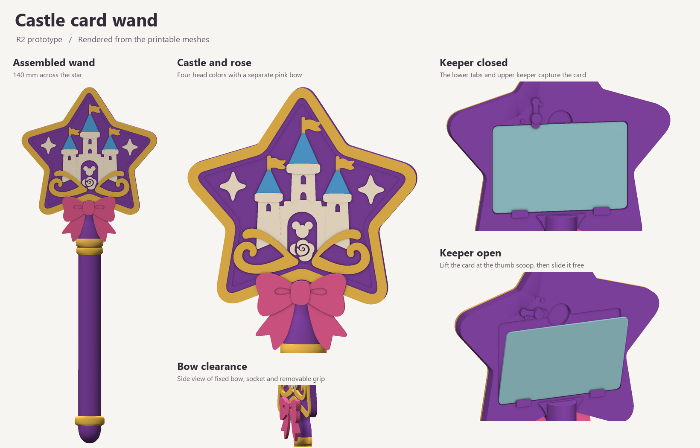

# Purple castle card wand

The R6 prototype reduces the star to 130 mm, insets the flags, and replaces the exposed rear keeper with a covered bottom-load channel closed by the full-size grip. [R6 design and verification notes](R6_DESIGN_NOTES.md)

The R5 revision clears the doorway beneath Mickey and follows the latest reference for the rounded pink bow and close-set gold curls. [R5 CAD and preview](cad/R5/README.md) · [R5 K2 plates](k2/R5/README.md)

The R3 revision has simpler gold curls and rounded castle and bow surfaces. [R3 CAD and preview](cad/R3/README.md) · [R3 K2 plates](k2/R3/README.md)

R2 is a printable prototype based on the purple-and-gold castle reference. It retains the pink bow and gold scrolls, replaces the crown with a cream Mickey head, and adds a cream spiral rose directly underneath.

## Load the card

Turn the rear keeper until it clears the pocket. Tilt the card toward you, tuck its lower edge under both fixed tabs, then lower the top into the pocket. Turn the keeper closed until it seats in its detent. To remove the card, release the keeper, lift the top edge through the thumb scoop, and slide the card upward out from under the tabs. The handle can stay attached throughout.

The landscape recess is 86.60 × 55.50 mm. The CAD path was checked with an 85.60 × 53.98 × 1.20 mm rigid card. The assembled star is 140 mm wide and the wand is about 369 mm long. An independent check found that an 8 mm round gauge can enter from the rear and reach under the seated card edge. Try fingertip access and detent feel on the coupon. See the [CAD assembly and coupon guide](cad/README.md) for the part stack, keeper, thread and fit checks.

## K2 0.4 mm trial plates

The five projects were sliced locally with the installed K2 0.4 mm profile and a Polymaker ASA starting profile. The project colors model the intended palette. Match spools to the assigned physical slots before printing. The K2 uses its chute for color swaps. Both the wipe tower and slicer priming are disabled.

| Project | Physical CFS slots | Slicer estimate |
| --- | --- | --- |
| [Card and thread fit coupon](k2/K2_04_ASA_Castle_Card_Loading_Coupon.3mf) | A purple | 2 h 54 min |
| [Castle star face](k2/K2_04_ASA_Castle_Star_Face.3mf) | A purple, B gold, C cream, D blue | 3 h 45 min |
| [Rear pocket and hardware](k2/K2_04_ASA_Castle_Reader_Pocket.3mf) | A purple | 3 h 40 min |
| [Threaded grip](k2/K2_04_ASA_Castle_Threaded_Grip.3mf) | A purple, B gold | 5 h 23 min |
| [Pink bow](k2/K2_04_ASA_Castle_Pink_Bow.3mf) | A pink | 41 min |

Print the fit coupon first and use the actual card to check the tabs, thumb access, keeper and thread. The grip and thread-stub coupon use removable build-plate supports. Physical fit, repeated keeper operation, adhesive bond strength, contactless tap performance, and final filament appearance remain unverified.

[Editable front artwork](art/R2/castle_front.svg) · [Reference detail](art/R2/rose_reference_detail.png) · [STEP assembly](cad/purple_castle_card_wand.step) · [CAD validation evidence](cad/validation_report.json) · [Slicer preflight evidence](k2/preflight.json) · [Rose toolpaths](k2/rose_toolpaths.png)

The CAD reuses the thread and cuff from the local Minnie derivative of JC’s Credit Card Wand (Flat Print), model 1636752, CC BY-NC. The rose and castle artwork are traced from the supplied references. [Mechanical donor listing](https://www.printables.com/model/1636752-credit-card-wand-flat-print)

