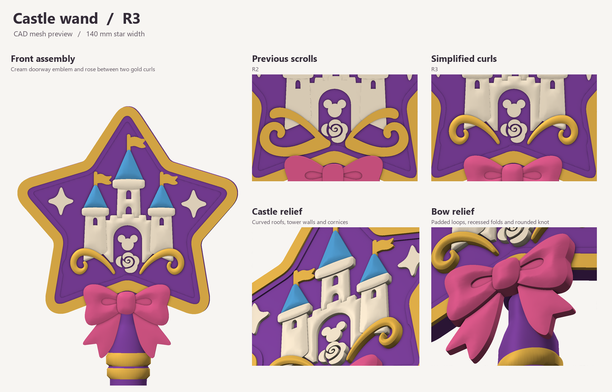

# R3 castle and bow relief

Two gold curls frame the rose beneath Mickey. Each curl follows a single unbranched ribbon, leaving more purple visible between the castle and the bow. The cream walls, blue roofs, cornices and gold curls have softly rounded faces. The pink bow has padded loops, recessed fold floors, gently rolled tails and a raised central knot.



The image uses the released print meshes. The upper details show the previous and revised curls at the same scale and camera angle. The lower oblique views show the depth of the castle and bow.

## Print and assemble

Load the four `head_*.stl` files from [print_parts](print_parts/) together as a single multipart object. Use purple for the carrier, gold for the rim, flags and curls, cream for the castle, Mickey and rose, and blue for the roofs. The head prints face-up on its flat joint face. Print `bow_pink.stl` separately with the sockets down and the curved faces up. The provisional process is K2, 0.4 mm nozzle and ASA.

The rear, keeper, pivot pin, both head keys, two-color grip and purple front carrier have identical STL hashes to R2. Use the [existing coupon, grip, pocket and assembly instructions](../README.md). The R3 bow seats on the same two fixed pads and pins. Its underside and blind sockets compare exactly through assembly Z14.99 mm. The card loads from the rear with the grip attached.

## Measured surface changes

All elevations use millimeters. A 0.25 mm grid cast 68,009 rays against the delivered STL surfaces. Rounded areas rise gradually from the edges and openings to a crown. The head datum is assembly Z9.80 mm and the bow datum is Z15.00 mm. The table gives the difference between the lowest and highest sampled top surface in each referenced feature.

| Feature | Measured crown rise |
|---|---:|
| Central keep, gatehouse and two tower walls | 0.67–0.79 mm |
| Three blue roofs | 0.88–0.89 mm |
| Three cream cornices | 0.41 mm |
| Two simplified gold curls | 0.60–0.63 mm |
| Two pink ribbon tails | 0.42 mm |
| Two padded loops | 1.06–1.07 mm |
| Central knot | 1.21 mm |

The loops crest at 3.80 mm above the bow datum, 2.00 mm above the flat fold floors. The knot crests at 4.80 mm above the datum. The three rose-petal surfaces remain at 2.40, 2.80 and 3.20 mm above the purple carrier. Mickey remains at 1.60 mm.

The [assembly STEP](purple_castle_card_wand_R3.step) reloads as 12 named components with 29 valid solids. The cream, blue, gold and pink parts contain 19 B-spline faces in total. All 12 print STL files reload as watertight, consistently wound positive-volume meshes. Rounded color areas project onto the supplied head regions with less than 0.00001 mm² measured difference per color. The bow's 0.04705 mm² projected difference from the unrounded artwork lies on the inherited 0.001 mm CAD grid. The largest measured overlap between two head colors is 0.000321 mm³.

The 169-position grip check measured 3.0368 mm minimum bow clearance. Fixed card geometry, the threaded interface and head/bow mounts match the R2 prototype. The [validation report](validation_report.json) includes individual part hashes, elevations, projected contours, interference and STEP checks. Physical fit, reader performance, appearance of the printed relief and bond strength remain untested.

## Editable inputs and rebuild

The [R3 control polygons](../../art/R3/castle_profiles.json) supply the revised silhouettes and color partition. The [relief map](../../art/R3/relief_map.json) sets nominal edge heights, crown heights and the width of the transition from edge to crown. The [artwork record](../../art/R3/art_review.md) identifies the visual references and the 59.09% reduction in paired scroll area. Project the original height-priority regions first to preserve visible windows, ribbons and artwork boundaries. The generator makes a smooth bicubic height field across each region, then clips it to the exact XY contour.

The [builder](build_r3.py) verifies both R3 inputs and the frozen R2 assembly by SHA-256. It imports the original fitted mechanical solids from the R2 STEP and copies their validated print meshes. The original mechanical attribution and usage notice apply. [R2 source record](../README.md#rebuild)

Run these commands from this directory using the repository's CadQuery 2.7 environment.

```powershell
& 'D:/Build/3D Prints/.venv/Scripts/python.exe' -B build_r3.py
& 'D:/Build/3D Prints/.venv/Scripts/python.exe' -B validate_r3.py
& 'D:/Build/3D Prints/.venv/Scripts/python.exe' -B render_r3.py
```

The released R3 STEP SHA-256 is `47154aecf3b182cc2261b42a7a764e737d8904dda519b5dac8431cb806119264`.
