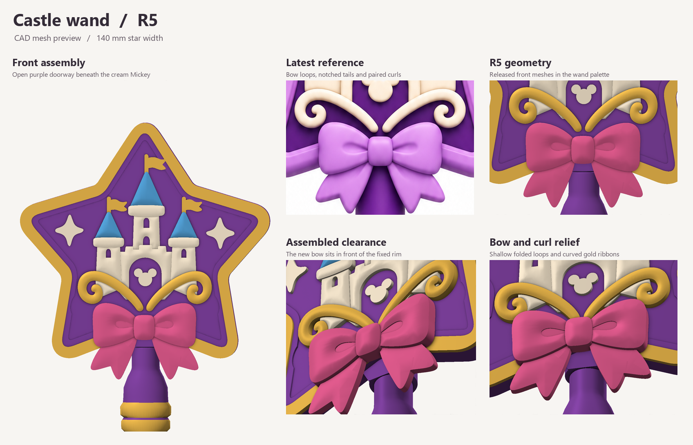

# R5 castle card wand

The rose has been removed from the doorway. Cream Mickey remains above an open purple field. Two gold curls sweep toward a narrow center seam over the pink knot. The bow takes its fuller loops, shallow pinches and shorter fishtail ends from the latest reference.



## Parts and assembly

Use the [R5 print meshes](print_parts/) at 100% in millimeters. Bring the four head STLs into the slicer as one multipart object. The carrier is purple, the rim and curls are gold, the castle and Mickey are cream, and the roofs are blue. Print the head with its flat bonding face on the bed. Print the pink bow separately with its two blind sockets down. These are designed for the project's 0.4 mm K2 ASA process.

The gold and cream head geometry and the pink bow changed from R3. The other nine STL files are byte-identical to R3, including the purple head carrier, blue roofs, rear card pocket, keeper, pivot, two keys and two grip colors. The [R2 instructions](../README.md) cover the thread and card coupons, assembly, card loading and tap orientation. Locate the bow on the two front pads at X ±20, Y −53 mm. Keep adhesive on those fixed pads.

## Dimensions from the print meshes

| Measurement | R5 result |
|---|---:|
| Star width | 140.00 mm |
| Bow width × height | 60.26 × 42.81 mm |
| Gold curl pair width | 75.216 mm |
| Purple seam between curl tips | 1.684 mm |
| Smallest front-view gap between a curl and the bow | 1.265 mm |
| Bow underside clearance over the gold rim | 1.600 mm |
| Smallest 3D gap from the bow to any gold head material | 1.402 mm |
| Minimum bow-to-grip clearance during the 169-position unscrewing check | 6.559 mm |

The bow and rim overlap by 302.12 mm² in a straight-on view. The bow underside sits at assembly Z13.20 mm, above the rim top at Z11.60 mm. Measurement through both 7.30 mm square mounting regions found zero material difference from the previous bow between Z13.19 and Z14.99 mm, including both blind sockets.

The curved gold ribbons crest 3.40 mm above the carrier face. The bow lobes crest 3.80 mm above the top of the backing, the shallow fold floors sit at 2.40 mm, and the knot crests at 4.80 mm. The [validation report](validation_report.json) measures the curved surfaces directly from the exported STLs. The former three-petal rose footprint contains zero remaining cream area.

## Source and checks

The [R5 reference registration and fitted artwork](../../art/R5/art_review.md) record how the latest picture was aligned to the 140 mm carrier and original mounting pads. The [editable generator](build_r5.py) uses the [R5 control polygons](../../art/R5/castle_profiles.json) and [relief map](../../art/R5/relief_map.json), retains the fitted mechanical assembly from R3 and rebuilds the changed colors using its bicubic surface method.

At the shared right tower and gatehouse seam, a 0.009 mm relief on the tower side removes an edge that otherwise joined two cream solids at a single point. This accounts for 0.138 mm² of projected cream difference from the artwork and gives watertight component meshes. The largest measured overlap between any two head colors is 0.000198 mm³.

The [complete colored STEP](purple_castle_card_wand_R5.step) reopens as 12 groups with 30 valid solids. Each of the 12 print STLs reloads with positive volume and consistent winding. A fresh build reproduced all 12 STL hashes. The release STEP SHA-256 is `26e2623d9702eae12372d11a601f0097114c06a24ef7ae14edc99760a1952c0a`. The validation report lists each STL hash and source hash. Physical fit, printed finish, joint strength and card-reader performance remain unverified.

Run these commands from this directory using the repository's CadQuery 2.7 environment.

```powershell
& 'D:/Build/3D Prints/.venv/Scripts/python.exe' -B build_r5.py
& 'D:/Build/3D Prints/.venv/Scripts/python.exe' -B validate_r5.py
& 'D:/Build/3D Prints/.venv/Scripts/python.exe' -B render_r5.py
```

The threaded connector and cuff derive from JC's *Credit Card Wand (Flat Print)*, model 1636752, under the prior Creative Commons Attribution–NonCommercial notice. [Mechanical source and artwork provenance](../README.md#rebuild)
