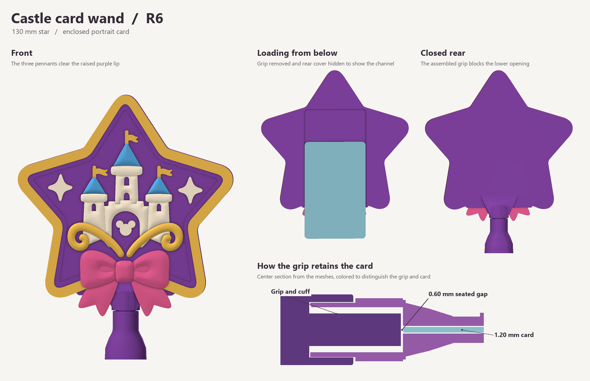

# R6 compact castle card wand

The 130 mm star encloses one portrait card. An adult unscrews the full-size grip, slides the card short edge first into the bottom of the star and reinstalls the grip. Its screw tip blocks the card's exit. The bonded head has five printed color groups across the front and bow, a rear cover and one full-size internal frame. The grip and the bonded head are the only assemblies used during card changes.



## Size and handling

The decorative star measures **130.00 × 122.60 mm**, reduced from R5's 140.00 × 132.03 mm. In the closed assembly the complete wand measures **130.00 × 373.86 × 21.80 mm**. The full-size portrait card moves the threaded grip 9.35 mm lower. Its tip-to-pommel length grows 4.59 mm compared with R5. The fixed star and its bare threaded connector together span 140.29 mm vertically.

The rear is closed. The purple field remains open beneath Mickey. The flag edges measured in the final meshes clear the raised purple lip by **4.07 mm on the left, 3.03 mm in the center and 2.95 mm on the right**. Their gold-rim clearances are 6.65, 5.61 and 5.49 mm respectively.

**Adult assembly and supervised handling are assumed.** A child may be able to unscrew the grip. Its opening torque, the durability of the bonded assembly and its suitability for a four-year-old have not been established by the CAD checks. Complete the physical checks below with a sample card before giving a child the wand.

## Print files

The nine [production STL files](print_parts/) are in millimeters, aligned in closed assembly coordinates. +Y points from the grip toward the top of the star, +Z faces the artwork and the screw lies on X = Z = 0. ASA with the project's 0.4 mm K2 setup is the provisional process.

| Printed object | Files and pose |
|---|---|
| Front cover, four materials | Import head_purple, head_gold, head_cream and head_blue together as **one multipart object**. Use the flat card-contact face as the bed face and print the artwork up. The upper female thread half is integral. |
| Rear cover, purple | rear_purple, rotate 180° about Y. The flat card-contact face goes on the bed. The lower female thread half is integral. |
| Internal frame, purple | frame_purple, print flat. The broad frame forms the side rails and upper stop after bonding. |
| Bow, pink | bow_pink, flat underside down with the relief up. Two shallow slots register on integral ribs in the fixed front. No separate fasteners are needed. |
| Grip, purple and gold | Import handle_purple and handle_gold together as **one multipart object**. Drop the long flat rear chord to the bed. The core runs through both collars and the pommel band. |

Print one of each object. The full-size frame sandwiches between the two covers, so the slicer never needs to bridge the 55 mm card cavity. Keep the smooth card-contact surfaces and female threads free of brim, adhesive and support residue.

## Fit coupons and adult assembly

1. Print the [four coupons](fit_coupon/) in the actual material, layer height and full-part orientations. The two windowed cover coupons, full-depth frame coupon and grip stub reproduce the real slot, upper stop, split female threads and cuff. The windows allow an adult to see the card edges during testing.
2. Dry-stack the frame between the two covers, matching the side and top edges and aligning the thread halves. Lightly clamp the fixed outer lands. With the stub removed, pass an actual sample card into the mouth between the thread halves. It should reach the upper stop and slide back out. Turn the stub by hand through engagement, seat its cuff and check the card stays captured during inversion and a gentle withdrawal attempt. Check successful release after removing the stub.
3. Dry-fit the full-size covers with the frame. Apply a thin, controlled layer of ASA-compatible adhesive to the broad fixed joining faces, especially the outer rails and upper field. Keep adhesive back from the card walls, slot mouth and screw. Align the outer silhouettes and both thread halves, clamp the fixed lands and allow the bond to cure with the card and grip removed. Recheck the thread and the full-length card path after curing.
4. Dry-seat the pink bow on the two molded locating ribs. Bond the **two broad flat loop lands** and let them cure. Their net planar contact area is **575.02 mm²** after the rib slots. The continuous 2.30 mm bow backing carries both tails. The three flags, two twinkles and cream Mickey use co-printed 0.80 mm deep stepped roots.
5. For use, an adult removes the grip, inserts the card and screws the grip fully home by hand. To unload, remove the grip completely, point the opening down and catch the card. Try the actual reader with the rear of the star toward it. Reader range depends on the reader, card and final assembly.
6. With a sample card installed, test repeated loading, inversion, gentle pulls on the grip and ornament, and representative accidental drops. Inspect the bonded seam, bow, tips, cuff and thread after each test and after repeated screw cycles. Retire a cracked part or loosened ornament. These physical tests, opening torque, thread wear and contactless operation remain pending.

## Geometry verification

| Feature | Released geometry |
|---|---:|
| Slot width × thickness | 55.00 × 1.80 mm |
| Nominal card width × length | 53.98 × 85.60 mm |
| Tested card thicknesses | 0.76 and 1.20 mm |
| Side clearance, centered | 0.51 mm per side |
| Clearance above and below a centered 1.20 mm card | 0.30 mm each |
| Front and rear skin thickness across the card field | 2.00 mm each |
| Main head panel thickness | 5.80 mm |
| Nominal side rail width above the rounded mouth corners | 2.15 mm |
| Minimum material from the upper pocket arc to the star edge | 2.03 mm |
| Frame-to-cover bonding land | 5,137.36 mm² per face |
| Seated card bottom / screw tip Y | −57.75 / −58.35 mm |
| Card travel to the installed grip | 0.60 mm |
| Bow-to-rotating-grip clearance | 4.91 mm minimum in sampled sweep |

The nominal seating pose leaves 0.05 mm before the upper stop. Pushing the card fully against that stop changes the gap to the screw tip from 0.60 to 0.65 mm. The 1.20 mm gauge passes through a continuous straight loading envelope with the grip removed, including nine lateral and face-offset combinations. In the closed assembly, the grip fills a 3.00 mm wide section through the full 1.80 mm slot at the mouth, while the skins constrain the card on either side. Of 486 candidate card escape poses with varied position, twist and tilt, 90 fit between the covers. The grip obstructed every one of those 90. The windowed coupon repeats the same dimensional checks. The tests model rigid cards; printed dimensions, card flexibility and roughness affect physical results.

The [released STEP](purple_castle_card_wand_R6.step) reloads as nine named groups with 28 valid solids. The [report](validation_report.json) includes all mesh hashes, connected-solid counts, winding, measured flags and mounts, card sweeps, engagement and screw motion. The imported thread pair produces zero measured solid interference at seven exact STEP positions across 21 mm of withdrawal. At the triangle level there are small seated thread residuals, up to 0.0201 mm³ per half across the 169-position sweep. The source cuff encloses the split neck and the proximal flared roots spread loads into both covers. The donor chamfer includes locally thin material, approximately 0.6–0.8 mm near the thread tip, so the physical thread and wear checks matter.

## Rebuild and source

The [editable CAD generator](build_r6.py) reads the frozen [R6 artwork](../../art/R6/castle_profiles.json) and [relief definitions](../../art/R6/relief_map.json). The 130 mm artwork imports directly at 1:1 in XY. The R5 curl and bow silhouettes supply the visual basis, with the three R6 flag and spire revisions. Both tower-to-gatehouse artwork seams receive 0.009 mm local relief to keep printed meshes manifold. [Artwork registration and flag measurements](../../art/R6/art_review.md)

The source for both split thread halves is the [Minnie derivative STEP](../../../minnie_ticket_wand/asa_cad/minnie_card_wand.step). The complete matched grip comes from the [R5 assembly](../R5/purple_castle_card_wand_R5.step). The split halves and grip move together by Y −9.35 mm. The halves retain their original thread axes and are trimmed at Z ±0.90 mm to widen the open slot. The original mechanical source is JC's *Credit Card Wand (Flat Print)*, model 1636752, under the prior Creative Commons Attribution–NonCommercial notice. [Original mechanical source record](../../../minnie_ticket_wand/asa_cad/README.md)

Run these commands from this directory using the repository's CadQuery 2.7 environment.

```powershell
& 'D:/Build/3D Prints/.venv/Scripts/python.exe' -B build_r6.py
& 'D:/Build/3D Prints/.venv/Scripts/python.exe' -B validate_r6.py
& 'D:/Build/3D Prints/.venv/Scripts/python.exe' -B render_r6.py
```

The released STEP SHA-256 is `a82407cd00a1db9faeb40fd8c2b01c9a81352e0b157cbc0662e062f34d2f612b`.
