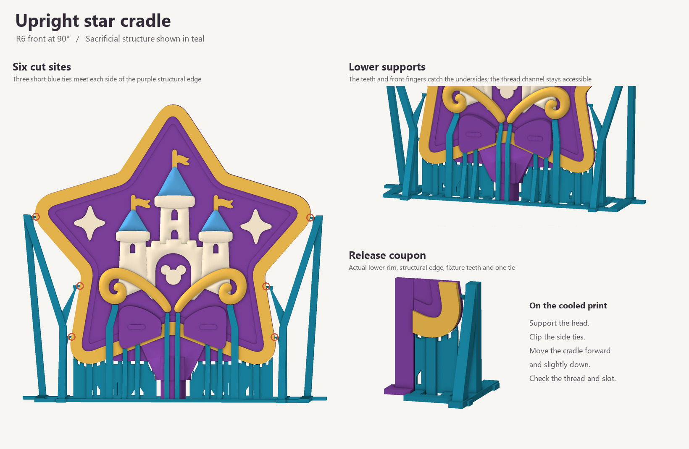

# Upright R6 star and removable cradle

The original four-color R6 front stands **exactly vertical**, with the thread end on the plate and the star tip 140.29 mm above it. One disposable blue PLA cradle catches the lower star points and braces the purple structural edge at six accessible cut sites. The vertical layers put the alternating red and blue lines across the visible castle face. The printed optical color and how readily the supports release still need a physical check.



## Plate setup

- Start from the four [original R6 head meshes](../print_parts/) and [blue-A cradle STL](upright_cradle_blue_A.stl). The [layout file](fixture_layout.json) records each source hash, the transforms and the intended contact locations. The [cradle STEP](upright_cradle_blue_A.step) supplies the editable solid exchange.
- Apply the same transform to each head STL in millimeters. For an assembly point `(x, y, z)`, the print coordinates are `(x, −z, y + 78.350)`. The cradle is already in print coordinates. Import them as one multipart object, and translate the complete group together for placement.
- The complete pre-placement envelope is **143.60 × 37.00 × 140.29 mm**. Its minimum corner is (−71.80, −19.00, 0), and its maximum corner is (+71.80, +18.00, 140.29). For a center at (130, 130), one common XY translation is (+130, +130.50).
- Use the matching K2 0.6 mm Unicorn PLA process, 0.20 mm first layer and 0.12 mm remaining layers. Keep the existing R6 optical purple, cream, blue and gold assignments. Assign the cradle directly to physical blue A. The shallow supports and first-layer offsets are specific to these layers.
- The reviewed full plate uses a 90° bridge angle, snug build-plate-only supplemental support at 8° assigned to A and a support blocker at the threaded throat. Its local slice reported no stability warning. The final slice reports 57.58 g for the model and support, 2,266 tool changes and 10 h 17 min 39 s of toolpath time. The K2's physical color changes and purge consumption are additional. A cradle-only slice retained a collapsing-overhang warning.

## Contact and removal

The lower comb has 22 teeth under the purple structural edge. Four fingers reach the lower edges of the bow-mounting pads. These 26 tips have a nominal **0.12 mm vertical air gap**. Six further catches sit under the two lower gold rim ends and four curl ends with a nominal **0.24 mm vertical air gap**. The nearest measured separation from the cradle to any gold mesh is 0.233 mm. The catches approach the underside of each feature, leaving the decorated front surface clear.

The six side ties are integrated temporary contacts. Each narrowed tip is 0.80 mm wide through the shell thickness and approximately 0.64 mm high. From the build plate they occur at **30.35, 54.35 and 87.00 mm**, once on each side. The preview circles the six locations. These ties carry lateral load during printing.

1. Start with the [three-part release coupon](release_coupon/), at the same scale, orientation, material and layer settings. It contains the actual lower right star edge, gold rim, cradle teeth and one full-size side tie. The purple heel is a local coupon handle. All three files are already in print coordinates, with a combined envelope of 29.50 × 34.00 × 34.50 mm. Keep their common origin and assign the blue cradle to A. Check that the lower tip prints continuously, the nib can be cut and the gapped contacts separate cleanly.
2. After cooling, remove the entire full-size assembly from the bed. Support the purple shell on the bench while an adult cuts all six narrow blue ties at the outer purple edge. Clear the small amount of generated support around the low exterior features. Use the marked edge locations to account for each clipped piece.
3. Hold the head steady. Move the cradle toward the decorated side and slightly downward toward the thread end, approximately **4 mm forward for each 1 mm down**. This motion clears the rear crossbar past the socket. If a finger remains bonded, cut that blue finger separately and remove it with the shell supported. Pulling straight up can catch the wider star shoulders on the braces.
4. Trim the blue remnants flush with the purple edge. Inspect the thread, card-contact surface, head bonding margin and the bow's two seating lands/ribs under good light. An adult should remove every loose fragment and check for sharp remnants, damage or delamination before any bonding or handoff to a child. Dry-fit the actual grip and card using the [R6 assembly tests](../README.md). Physical release force, thread finish, optical appearance and suitability for child handling remain unverified.

## Measured geometry

The [validator](validate_fixture.py) checked all 1,168 nominal model layer centers. Two new model islands appeared at 17.78 mm, one per lower star point. Both have cradle material beneath them within the 0.12 mm release-gap region. The final fixture has no unanchored fixture starts greater than 0.10 mm² in this check. At the first layer the head presents **13.09 mm²** and the cradle **2,055.10 mm²** of geometric bed contact.

The source STL transforms preserve all card and thread geometry. The actual cradle clears the card-contact plane and mating margin by **0.475 mm**, the bow seating lands and ribs by **0.943 mm**, and a protected R6.25 mm cylinder around the first 21 mm of the threaded throat by **1.747 mm**. The local mesh test measured under 0.000001 mm³ volumetric overlap with the head. The intended side ties meet along exterior surfaces.

The largest geometric reach remaining in the cradle-only model is over the internal thread root at Z20.54 mm. The slicer controls the actual bridge direction there. Geometry-only checks do not establish physical bridging or color quality. After modeling the six tip cuts, the cradle remained one solid and moved 28 mm forward and 7 mm down with zero intersections in 281 sampled poses. This test covers the modeled cradle; the supplemental slicer support is removed separately.

The [validation report](validation_report.json) records the STL and STEP hashes, contact clearances, geometric overhang locations and post-trim extraction check. The final [editable generator](build_fixture.py) reproduced the released support STL byte-for-byte in a separate scratch build. Its SHA-256 is `2756321e8c85cc001c3f5a01c3b486ed41ec27591c4ed0d61c8ba0a9e0f324d1`.

From this directory, using the repository Python environment:

```powershell
& 'D:/Build/3D Prints/.venv/Scripts/python.exe' -B build_fixture.py
& 'D:/Build/3D Prints/.venv/Scripts/python.exe' -B build_coupon.py
& 'D:/Build/3D Prints/.venv/Scripts/python.exe' -B validate_fixture.py
& 'D:/Build/3D Prints/.venv/Scripts/python.exe' -B render_fixture.py
```
