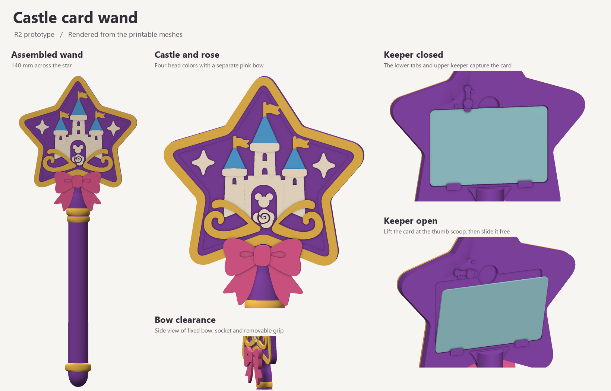

# Purple castle card wand

The 140 mm star carries a landscape card on the back. Slide one long card edge under the two lower tabs, lower the other edge and turn the keeper over it. The grip can stay attached during loading. The complete wand measures **140.00 × 369.27 × 29.10 mm** in front-view X, Y and Z.



## Print parts

All [production meshes](print_parts/) retain their closed assembly coordinates in millimeters. +Y points toward the star tip and +Z points out of the decorated face. Drop each independent object to the bed after setting its print orientation. The provisional target is a K2, 0.4 mm nozzle and ASA.

| Part | Quantity | Print setup |
|---|---:|---|
| head_purple, head_gold, head_cream, head_blue | One multipart head | Preserve relative coordinates. Flat joint face on bed, artwork up. Purple carrier, gold rim/scrolls/flags, cream castle/Mickey/rose/stars and blue roofs. |
| handle_purple, handle_gold | One multipart grip | Preserve relative coordinates. The long rear chord lies flat in the supplied pose. The continuous purple core passes through three gold bands. The 253.57 mm grip fits diagonally. Use the reviewed support settings for the horizontal thread and cuff. |
| bow_pink | 1 | Flat underside down, relief up. The two shallow underside sockets locate the bow. |
| rear_purple | 1 | Rotate 180° about Y so the flat bonding face is on the bed and the pocket faces up. Both lower tabs are integral. Remove any debris below the tabs and from the thread. |
| keeper_purple, pivot_pin_purple | 1 each | Print as oriented, separately. The keeper's flat outer surface and the pivot's broad cap each sit on the bed. |
| shell_key_1_purple, shell_key_2_purple | 1 each | Print upright on their circular ends as oriented. One key locates each side of the bonded head. |

For four-slot CFS, the head uses slot 1 purple, 2 gold, 3 cream and 4 blue. The grip uses slots 1 and 2. The pink bow uses a separate plate and an available slot loaded with pink. The rear and hardware use purple. The color in the preview approximates the intended filament.

## Fit coupons and assembly

1. Print the three [fit coupons](fit_coupon/) at 100% plus an extra production keeper and pivot pin. Orient the card frame and socket like the rear shell. Orient the short threaded grip like the full grip. The frame duplicates the pocket perimeter, both fixed tabs, upper scoop, pivot and stops. Its large central opening saves material. The socket and grip stub preserve the thread and cuff.
2. Test the thread stub by hand through the full travel. To fit the keeper, lay its flat face outward, its detent nose toward the frame and its short tongue toward the pocket. Slip the pivot through the hub until its shoulder sits on the fixed deck. First dry-fit. For a functional test, place a tiny spot of ASA-compatible adhesive **at the bottom of the blind pilot hole** using a fine applicator, then install the pin. Leave the journal, head, detent and two seats clean. After curing, lift the long finger end slightly and sweep it between the two stops. Check both positions with your actual card.
3. Dry-fit the two full-size head halves using their two short keys. Apply a thin film of ASA-compatible adhesive to fixed, flat mating areas and key seats. Keep the card out and keep the perimeter, thread, rear mechanism and registration faces clean. Press the halves flush and let the bond cure. Fit the bow to the two front bosses and bond only the circular mounting pads. The knot and tails overhang the grip.
4. Fit the full-size rear keeper using the same dry-fit and pin procedure. Screw the laminated purple/gold grip into the neck by hand. The plate-to-rear bond transfers head load to the fixed threaded sleeve. The bow attaches to the head. Carry and turn the wand by its grip.
5. Open the keeper until the finger end seats near the side stop. Hold the card in landscape orientation, about 15° from flat, with its bottom edge nearest the two lower tabs. Slide that edge under both tabs, lower the upper edge into the pocket and turn the keeper closed. The short tongue covers the upper edge. To remove, open the keeper, lift at the center thumb scoop, slide the tilted card about 2.65 mm toward the scoop to clear the tabs, then lift it out.
6. Present the exposed card side to the reader. The card sits below the rear features. A 0.76 mm flat card sits 5.06 mm behind the pivot cap. Position the upper head over the reader so the lower neck and grip can overhang. Tap range depends on the actual card and reader.

## Geometry and checks

The [editable generator](build_wand.py) consumes the frozen [R2 artwork](../art/R2/castle_profiles.json), SHA-256 `157e4526ce2e8a31cf1bcfd0d903d3c1fd56db4d6431e11811acd003a2974cfa`. Input XY coordinates already include artwork scaling and orientation. The generator uses a 0.001 mm planar precision grid. Head heights follow R2's height-priority rule. The bow has a continuous 1.80 mm backing. Two 7.08 mm diameter front pads set its underside 3.40 mm beyond the carrier face. The grip's rounded profiles follow the artwork's width, band positions and overall length. Its underside has a flat printing chord.

| Feature | Design value |
|---|---:|
| Card pocket and corner radius | 86.60 × 55.50 mm, R3.25 mm |
| Nominal card gauge tested | 85.60 × 53.98 × 1.20 mm, R3.18 mm |
| Centered card clearance | 0.50 mm at each side, 0.76 mm at each end |
| Minimum wall between pocket and star perimeter | 3.529 mm |
| Material between seated card and flat head joint | 2.80 mm |
| Lower tab clear height above card floor | 2.30 mm |
| Upper keeper clear height above card floor | 2.52 mm |
| Worst in-plane capture with card at an end of its travel | 0.67 mm lower / 1.08 mm upper |
| Rocker swing and running clearance | 80°, 0.30 mm radial clearance at journal |
| Keeper hub axial free travel | 0.26 mm |
| Detent nose displacement to leave its seat | 0.42 mm to clear deck, shared by hub play and flexure |
| Thumb scoop | 16 mm diameter, 1.90 mm below floor |
| Grip core inside the gold bands | Ø14.10 mm |
| Handle thread | 3.00 mm pitch, drawn at the source scale |

The [validation report](validation_report.json) reloads every production and coupon STL plus the [colored assembly STEP](purple_castle_card_wand.step). It records all part hashes, 29 valid STEP solids in 12 named groups, manifold checks, intersections, card positioning and retention. The full-thickness card clears every sampled pose at 13°, 15° and 16°, across approach, tuck, tilt and seating (576 poses). A 13 mm diameter gauge fits beneath the upper card edge in the scoop. The two stops bound keeper rotation. The underside nose intentionally flexes past the deck between its two seats. Detent force, wear, bond strength, actual card and reader performance need physical tests.

The screw sweep covers 21.00 mm of withdrawal. The exact source and re-imported production STEP pairs have zero measured overlap at 17 poses each. The denser print-mesh check covers 169 poses. At the seated position, the faceted thread surfaces have a maximum aggregate overlap of 0.0362 mm³. The largest individual connected fragment is below 0.00172 mm³, distributed across the threaded region. Three color boundaries have sub-0.0005 mm³ residual overlap on the 0.001 mm artwork grid. The grip bands, fixed head versus bow, and bow versus rotating grip have zero measured interference. Minimum sampled bow-to-grip clearance is 3.037 mm, 60° into the first turn. The angled card clears the fixed tabs by 0.499–0.600 mm at its fully tucked position. The narrow inner rose gap and small detent dimensions should be checked on the actual 0.4 mm print.

## Rebuild

Run these from this directory with the repository environment.

```powershell
& 'D:/Build/3D Prints/.venv/Scripts/python.exe' -B build_wand.py
& 'D:/Build/3D Prints/.venv/Scripts/python.exe' -B validate_wand.py
& 'D:/Build/3D Prints/.venv/Scripts/python.exe' -B render_wand.py
```

The matched thread and rotating cuff come from the [Minnie derivative STEP](../../minnie_ticket_wand/asa_cad/minnie_card_wand.step), SHA-256 `fd40571d938553f20a34d1777a30869eaa36b0a24a456f3d2d79b8a8a344b86d`. The upstream mechanical reference is *Credit Card Wand (Flat Print)* by JC, model 1636752, credited under Creative Commons Attribution–NonCommercial in the [Minnie source record](../../minnie_ticket_wand/asa_cad/README.md). This build extracts the complementary female thread halves, male screw and integrated cuff and joins them to the castle carrier and new long grip. Artwork provenance is documented in the [R2 art record](../art/R2/art_review.md). [Original maker listing](https://www.printables.com/model/1636752-credit-card-wand-flat-print)

